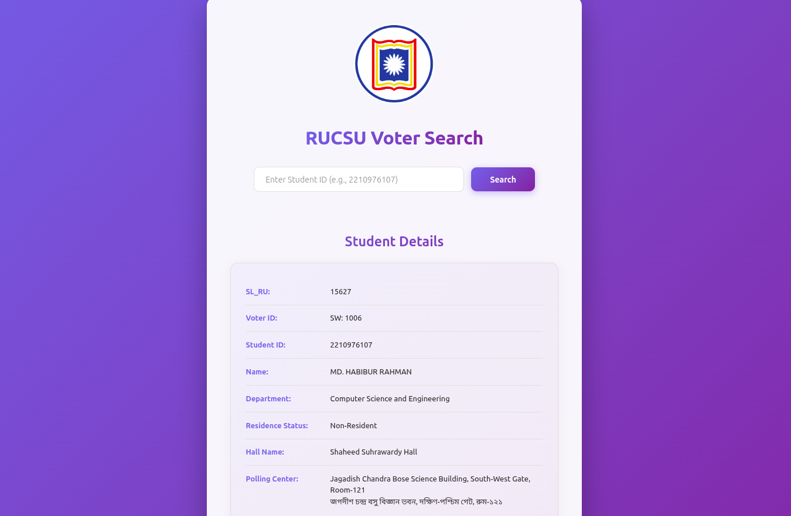

<div align="center">

# RUCSU Voter Search

### Find student voter information and polling-center details in seconds

A fast, responsive React application for looking up RUCSU voter information with a Student ID.

<p>
  
</p>

</div>

## Overview

**RUCSU Voter Search** connects to Firebase Realtime Database and presents a student's voter information in a clear, easy-to-read result card. Enter a valid Student ID to view the student's voter record, residence status, assigned hall, and polling center in both English and Bangla.

## Features

- Search voter records by Student ID
- Retrieve data from Firebase Realtime Database
- Show loading and validation states
- Display:
  - SL_RU
  - Voter ID
  - Student ID
  - Name
  - Department
  - Residence status
  - Hall name
  - Polling-center name and location
- Map hall codes to their full hall names
- Show polling-center details in English and Bangla
- Responsive interface with a modern gradient design
- Press **Enter** to search from the Student ID field

## Tech stack

- [React](https://react.dev/) 19
- [Vite](https://vite.dev/) 7
- [Firebase Realtime Database](https://firebase.google.com/docs/database)
- JavaScript (ES modules)
- CSS


## Project structure

```text
.
├── public/
│   └── response.png       # Application preview
├── src/
│   ├── App.jsx            # Search flow and voter details UI
│   ├── App.css            # Application styling
│   ├── index.css          # Global styles
│   └── main.jsx           # React entry point
├── firestore.js           # Firebase initialization
├── index.html
└── package.json
```

## Data flow

1. The user enters a Student ID.
2. The app reads the matching record from Firebase Realtime Database.
3. The voter record is displayed with the corresponding hall and polling-center information.
4. Missing or unavailable records are reported with an error message.


