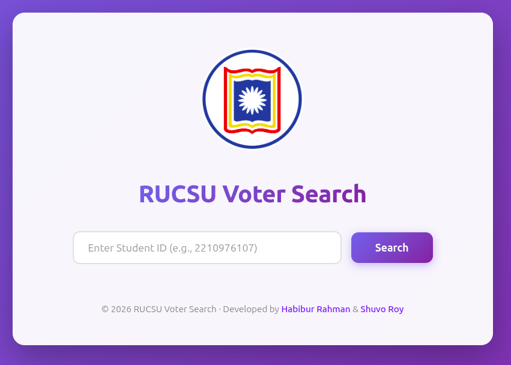
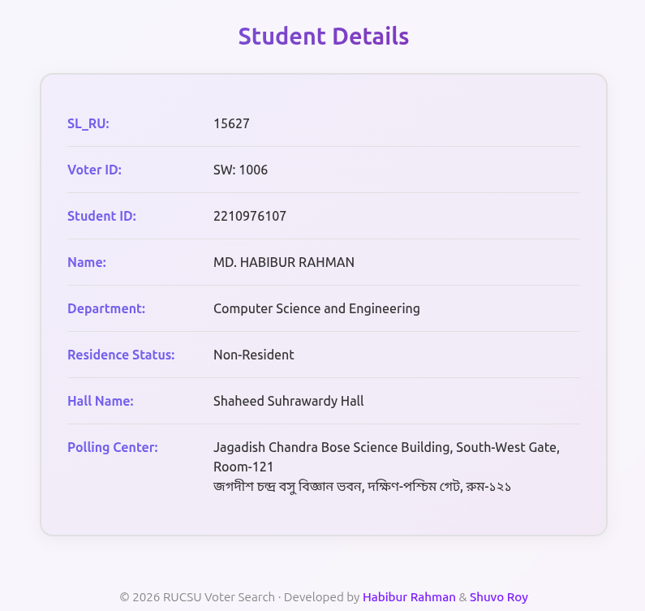
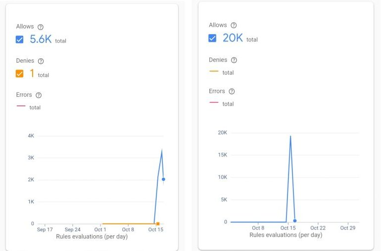

<div align="center">

# RUCSU Voter Search

### A simpler way to find voter information for the RUCSU Election 2025

Students at the University of Rajshahi can enter their Student ID to quickly find their voter information, assigned hall, and polling center without downloading and searching through large PDF voter lists.

<table>
  <tr>
    <td align="center">
      
      <br>
      <sub><strong>Main page</strong></sub>
    </td>
    <td align="center">
      
      <br>
      <sub><strong>Student details</strong></sub>
    </td>
  </tr>
</table>

<p>
  <strong>25,000+ successful searches in the first two days</strong>
</p>

</div>

## About the project

**RUCSU Voter Search** is a useful web app built for the **Rajshahi University Central Students Union (RUCSU) Election 2025**. It makes voter verification faster and more convenient by providing student-specific election information through a simple Student ID search.

Instead of downloading a large voter-list PDF and manually searching through it, students can use this platform to get the information they need in seconds.

## Impact

The platform handled more than **25,000 successful searches within two days of going live**, helping students across the University of Rajshahi quickly find their voter information and reducing confusion around the election process.

<div align="center">
  
  <br>
  <sub>Firebase usage analytics after launch</sub>
</div>

## Features

- Search voter records by Student ID
- Retrieve records from Firebase Realtime Database
- Display student and voter information, including:
  - SL_RU
  - Voter ID
  - Student ID
  - Name
  - Department
  - Residence status
  - Assigned hall
  - Polling center
- Show polling-center details in English and Bangla
- Map hall codes to full hall names
- Provide loading, validation, and unavailable-record feedback
- Press **Enter** to search from the Student ID field
- Responsive interface with a clean, modern gradient design

## Tech stack

- [React](https://react.dev/) 19
- [Vite](https://vite.dev/) 7
- [Firebase Realtime Database](https://firebase.google.com/docs/database)
- JavaScript (ES modules)
- CSS

## Deploy to GitHub Pages

This repository is configured to deploy automatically to GitHub Pages from the
`main` branch using GitHub Actions.

To enable the first deployment:

1. Open the repository's **Settings → Pages**.
2. Set **Source** to **GitHub Actions**.
3. Push to `main`, or run the **Deploy to GitHub Pages** workflow manually from
   the **Actions** tab.

The site will be available at
`https://pipra1.github.io/rucsu/`.

## How it works

1. A student enters their Student ID.
2. The app looks up the matching record in Firebase Realtime Database.
3. The voter record is displayed with the student's hall and polling-center information.
4. Hall codes are converted into full hall names, and polling-center information is shown in English and Bangla.

## Project structure

```text
.
├── public/
│   ├── MainPage.jpeg      # Main-page preview
│   ├── studentDetails.png # Student-details preview
│   └── response.jpeg      # Firebase usage analytics
├── src/
│   ├── App.jsx            # Search flow and voter details UI
│   ├── App.css            # Application styling
│   ├── index.css          # Global styles
│   ├── main.jsx           # React entry point
│   └── firebase.js        # Firebase initialization
├── index.html
└── package.json
```
